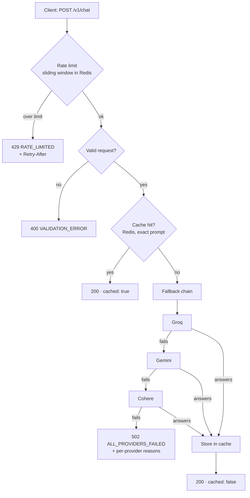

[](https://github.com/Sahil3801/llm-gateway/actions/workflows/ci.yml)

# LLM Gateway

One REST API in front of multiple LLM providers (**Groq, Google Gemini, Cohere**) with automatic
**fallback**, **Redis response caching** and **per-client rate limiting**.

Apps call `POST /v1/chat` and always get the same response shape, whichever provider answered. If
a provider is down, rate-limited or misconfigured, the gateway quietly tries the next one.

Built with Java 21, Spring Boot 3, Redis, Docker, JUnit 5, WireMock and Testcontainers.

---

## Why

| Without a gateway | With this gateway |
|---|---|
| Each app calls a provider directly; provider down = app down | Automatic fallback to the next provider; apps don't notice |
| Keys, retries and limits duplicated in every app | One place for all of it |
| Same question paid for twice | Identical prompts served from Redis |
| One noisy client can burn the shared quota | Each client gets its own rate limit |

## Features

- **Unified API**: one request/response format for every provider (`POST /v1/chat`).
- **Provider adapters** behind a single `LlmProvider` interface. Adding a provider = adding one class.
- **Config-driven provider choice**: primary provider and fallback order set by environment variables.
- **Fallback chain**: moves on after rate limits, timeouts, 5xx errors, bad keys or unknown models;
  stops on prompts a provider rejects (e.g. safety filter), so they aren't sent everywhere.
- **Response cache** in Redis keyed on the exact prompt text, with a configurable TTL (default 1 hour).
- **Per-client rate limiting**: sliding window in Redis, implemented as an atomic Lua script.
- **Clean errors**: every failure is RFC 7807 JSON with a stable `errorCode`. Never a stack trace.
- **Resilient to Redis outages**: the cache degrades to a miss; the rate limiter is fail-open by default.
- **No secrets in code**: all API keys come from environment variables.

## How a request flows



The order is deliberate: the rate limit runs **before** the cache, so cached answers still count
towards a client's limit.

## API

### `POST /v1/chat`

| Header | Required | Purpose |
|---|---|---|
| `Content-Type: application/json` | yes | |
| `X-Client-Id` | no | Identifies the caller for rate limiting (1–64 chars: letters, digits, `.` `-` `_`). Without it, the caller's IP is used. |

```json
{
  "prompt": "Summarise this claim: ...",
  "max_tokens": 256,
  "temperature": 0.2
}
```

| Field | Required | Rules |
|---|---|---|
| `prompt` | yes | not blank, max 32,000 characters |
| `max_tokens` | no | 1–8192 (default 1024) |
| `temperature` | no | 0.0–2.0 (default: the provider's own) |

**Response (200)**: same shape for every provider:

```json
{
  "id": "4f0c2b1e-...",
  "provider": "gemini",
  "model": "gemini-2.5-flash",
  "content": "The claim concerns ...",
  "finish_reason": "stop",
  "usage": { "prompt_tokens": 42, "completion_tokens": 88, "total_tokens": 130 },
  "cached": false,
  "fallbacks": 1,
  "latency_ms": 412
}
```

- `fallbacks`: how many providers failed before this one answered.
- `cached`: `true` if the answer came from Redis and no provider was called.
- `usage` fields are `null` when the provider doesn't report them.

Responses from `/v1/chat` also carry `X-RateLimit-Limit` and `X-RateLimit-Remaining` headers.

### Errors

All errors are `application/problem+json`, with an `errorCode` clients can switch on:

```json
{
  "status": 502,
  "title": "Bad Gateway",
  "detail": "All LLM providers failed to answer. Please retry later.",
  "errorCode": "ALL_PROVIDERS_FAILED",
  "attempts": [
    { "provider": "groq",   "outcome": "RATE_LIMITED" },
    { "provider": "gemini", "outcome": "SERVER_ERROR" },
    { "provider": "cohere", "outcome": "TIMEOUT" }
  ]
}
```

| HTTP | `errorCode` | When |
|---|---|---|
| 400 | `VALIDATION_ERROR` | Bad body, bad JSON or bad `X-Client-Id` |
| 400 | `PROVIDER_REJECTED_REQUEST` | A provider refused the prompt itself (e.g. safety filter, too long) |
| 429 | `RATE_LIMITED` | Client over its limit; `Retry-After` says when to retry |
| 502 | `ALL_PROVIDERS_FAILED` | Every provider was tried and failed; `attempts` lists why |
| 503 | `NO_PROVIDER_CONFIGURED` | No provider has an API key |
| 503 | `RATE_LIMITER_UNAVAILABLE` | Redis is down and the limiter is set to fail-closed |
| 500 | `INTERNAL_ERROR` | Unexpected error (details only in the server log) |

## Quick start

**Prerequisites:** Docker. For running without Docker: Java 21 and a Redis you can reach. Maven is
not needed; the project ships the Maven wrapper.

**1. Get at least one API key** (each offers a free tier or trial key):
[Groq](https://console.groq.com) · [Google AI Studio (Gemini)](https://aistudio.google.com) · [Cohere](https://dashboard.cohere.com)

**2. Configure:**

```bash
git clone https://github.com/Sahil3801/llm-gateway.git
cd llm-gateway
cp .env.example .env        # Windows: copy .env.example .env
# then put your key(s) in .env
```

**3a. Run everything in Docker** (Redis + gateway):

```bash
docker compose up -d --build
```

**3b. Or run the app locally** and only Redis in Docker:

```bash
docker compose up -d redis
./mvnw spring-boot:run        # Windows: .\mvnw.cmd spring-boot:run
```

When running locally, the keys must be in your environment (e.g. PowerShell:
`$env:GROQ_API_KEY="..."`), or in VS Code use a launch configuration with `"envFile": "${workspaceFolder}/.env"`.

**4. Try it:**

```bash
curl -X POST http://localhost:8080/v1/chat \
  -H "Content-Type: application/json" \
  -H "X-Client-Id: my-app" \
  -d '{"prompt": "Explain Redis in one sentence."}'
```

PowerShell:

```powershell
Invoke-RestMethod -Method Post -Uri http://localhost:8080/v1/chat `
  -Headers @{ "X-Client-Id" = "my-app" } -ContentType "application/json" `
  -Body '{"prompt":"Explain Redis in one sentence."}'
```

Send the same request again: the response shows `"cached": true`.

Health check: `GET http://localhost:8080/actuator/health`.

## Configuration

Everything is set with environment variables (see [`.env.example`](.env.example)). Defaults live in
[`application.yml`](src/main/resources/application.yml).

| Variable | Default | Meaning |
|---|---|---|
| `GROQ_API_KEY`, `GEMINI_API_KEY`, `COHERE_API_KEY` | *(empty)* | Provider keys. A provider without a key is skipped. |
| `LLM_PROVIDER` | `groq` | Primary provider, tried first |
| `LLM_FALLBACK_PROVIDERS` | `gemini,cohere` | Tried in order when the primary fails. Empty = no fallback. |
| `GROQ_MODEL` | `openai/gpt-oss-20b` | Model per provider |
| `GEMINI_MODEL` | `gemini-2.5-flash` | |
| `COHERE_MODEL` | `command-a-03-2025` | |
| `CACHE_ENABLED` | `true` | Response cache on/off |
| `CACHE_TTL` | `1h` | How long answers stay cached (`30m`, `1h`, `1d`, ...) |
| `RATE_LIMIT_ENABLED` | `true` | Rate limiting on/off |
| `RATE_LIMIT_REQUESTS` | `20` | Max requests per client... |
| `RATE_LIMIT_WINDOW` | `1m` | ...in any rolling window of this length |
| `RATE_LIMIT_FAIL_OPEN` | `true` | If Redis is down: `true` = allow requests, `false` = reject (503) |
| `REDIS_HOST`, `REDIS_PORT`, `REDIS_PASSWORD` | `localhost`, `6379`, *(empty)* | Redis connection |
| `PORT` | `8080` | HTTP port |

> Providers change their model lineups often. Check each provider's console for current model
> names and override them with the `*_MODEL` variables. A wrong or retired model name returns 404
> from the provider, which the gateway logs as an error and treats as "try the next provider".

The app checks its configuration at startup: an unknown provider name (e.g. `LLM_PROVIDER=gemni`)
or an invalid value stops it immediately with a clear message, and the log shows what is usable:

```
LLM providers: cohere=ready, gemini=ready, groq=no API key. Fallback chain: groq -> gemini -> cohere
Response cache: enabled, TTL 3600s
Rate limit: 20 requests per 60.0s per client (fail-open)
```

## Design decisions

**Fallback: which failures move on, which stop.**
Rate limits, timeouts, 5xx and unreadable answers are provider-side problems: try the next provider.
A bad API key (401/403) or unknown model (404) is a config problem with *that* provider: log an
error and try the next one. A prompt the provider rejects (other 4xx, safety block) stops the chain:
retrying elsewhere would mostly fail the same way, burn quota, and send a refused prompt to every
other provider. A total time budget (60s) stops several slow providers adding up into one very
long request.

**Every provider failure is translated into one small vocabulary** (`RATE_LIMITED`, `TIMEOUT`,
`SERVER_ERROR`, `AUTH_FAILED`, `MODEL_NOT_FOUND`, `BAD_REQUEST`, `INVALID_RESPONSE`). The fallback
logic decides on these, never on provider-specific details.

**Cache key = SHA-256 of the exact prompt text.** Fixed-length keys, and prompt text (possibly
personal data) never appears in Redis key listings. Only complete answers (`finish_reason: stop`)
are cached, so an answer cut short by a small `max_tokens` is never served to later callers.
Because the key is the prompt only, the same prompt with different `temperature` shares one entry.

**Sliding-window rate limit as a Redis Lua script.** A fixed window ("20 per calendar minute")
allows 40 requests in two seconds across a minute boundary; a sliding window doesn't. Each client
has a sorted set of request timestamps. "Remove expired, count, add" must be one atomic step, or
parallel requests could all see "19 used" and slip through, so it runs as a Lua script inside
Redis, using Redis's clock so multiple gateway instances agree on time. Rejected requests aren't
recorded, so a client that keeps retrying doesn't push its own unblock time further out.

**Redis is optional for availability.** Redis calls have 500 ms timeouts (instead of the 60 s
default). If Redis is down, the cache behaves like a miss and the rate limiter lets requests
through (fail-open, configurable). Redis is excluded from the health check, so a cache outage
doesn't get the gateway container restarted.

**Virtual threads (Java 21).** LLM calls spend seconds waiting on the network. Virtual threads
make that waiting cheap, so plain blocking code scales without a reactive framework.

**Security basics.** Keys only come from the environment and are masked when settings are printed; the
Gemini key is sent in a header, not the URL (URLs end up in logs); prompts are never logged; the
container runs as a non-root user.

## Testing

```bash
./mvnw test        # Windows: .\mvnw.cmd test   (Docker must be running)
```

67 tests, no API keys needed. CI runs them on every push and pull request.

| Kind | What it covers |
|---|---|
| Unit | HTTP status → failure reason mapping; every fallback rule; config defaults and key masking |
| WireMock | Each provider adapter: exact request sent (headers, body), response mapping, error mapping, timeouts |
| Testcontainers (real Redis) | Sliding window, 50 parallel requests against a limit of 20 (exactly 20 allowed), TTL expiry, exact-text keys, Redis-down behaviour |
| Full application (MockMvc) | The whole request path: normalised response, fallback on 429/404, clean 502 without stack traces or keys, cache hits, 429 with `Retry-After`, validation |

## Project structure

```
src/main/java/io/github/sahil3801/gateway/
├── api/          ChatController, request/response DTOs
├── service/      ChatService (orchestration), FallbackExecutor
├── provider/     LlmProvider interface, ProviderRegistry, shared HTTP + error mapping
│   ├── groq/     GroqProvider
│   ├── gemini/   GeminiProvider
│   └── cohere/   CohereProvider
├── cache/        ResponseCache (Redis)
├── ratelimit/    RateLimiter, RateLimitInterceptor
├── config/       Typed, validated configuration
└── common/       GlobalExceptionHandler (RFC 7807 errors)
src/main/resources/
├── application.yml
└── redis/sliding_window.lua
```

## Limitations and next steps

- **No authentication.** Clients identify themselves with `X-Client-Id`, which a caller could vary
  to dodge the rate limit. Per-client API keys would fix this.
- **Cache key ignores `temperature` and `max_tokens`** by design (see above).
- **No retry of the same provider**: the gateway falls back to the *next* provider instead.
- **No streaming** responses.
- Provider adapters are tested against each provider's JSON format with WireMock; there are no
  automated tests against the live APIs.
- Possible next steps: per-client API keys, metrics and tracing (Micrometer / OpenTelemetry),
  token/cost tracking per client, streaming.
